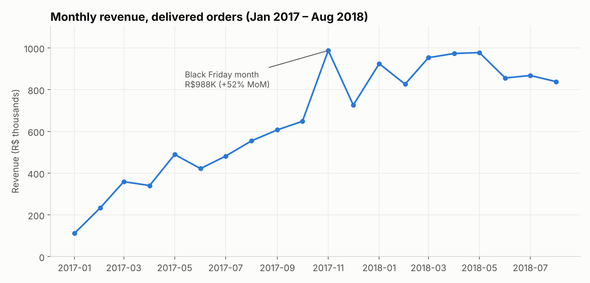
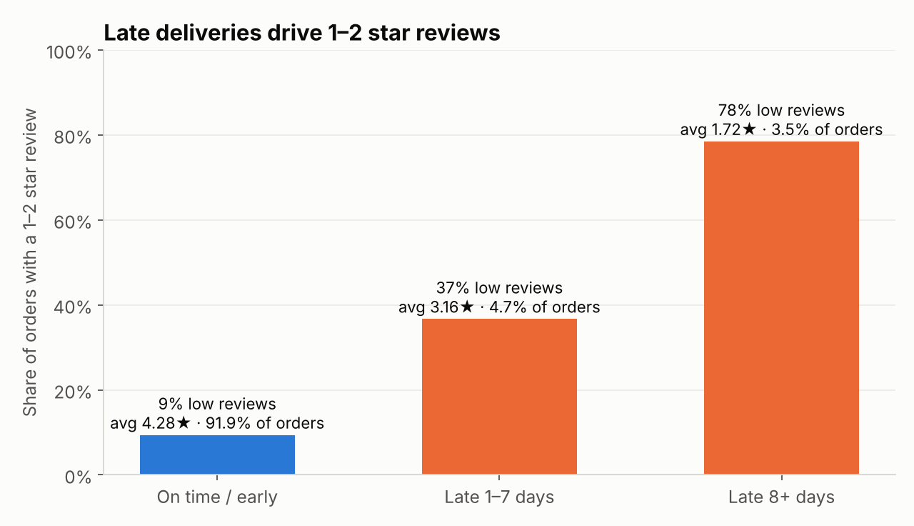
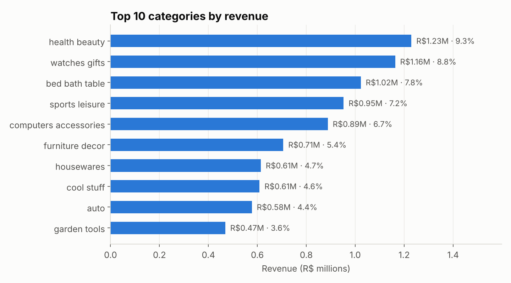
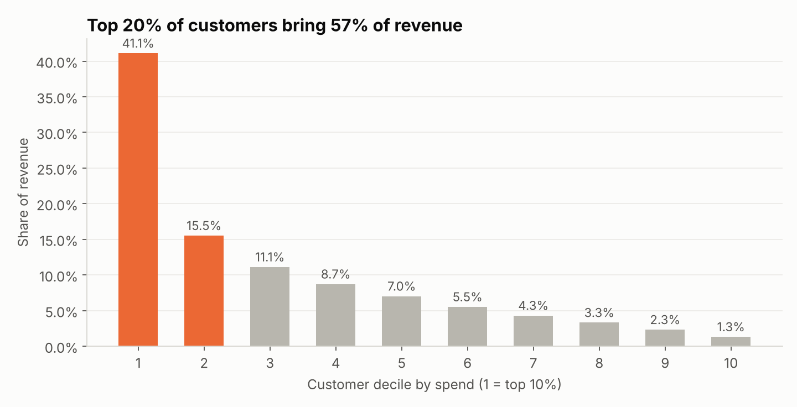
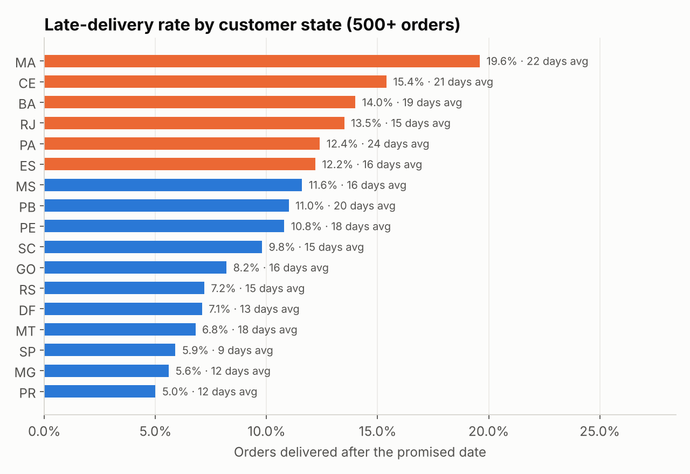

# E-commerce Sales & Customer Analytics — PostgreSQL + Power BI

**Business question:** Where does an online marketplace's revenue come from, what is
hurting customer satisfaction, and which customers are worth keeping?

**Data:** [Olist Brazilian E-Commerce Public Dataset](https://www.kaggle.com/datasets/olistbr/brazilian-ecommerce)
— real, anonymised marketplace data: ~99K orders, 112K order items, 8 linked tables, Sep 2016 – Oct 2018.
Analysis window: **Jan 2017 – Aug 2018** (the months before and after are partial).

**Tools:** PostgreSQL 16 · SQL (CTEs, window functions, NTILE, cohort logic) · Python (pandas, matplotlib) · Power BI (star schema, DAX)

---

## Key findings

| | Finding | So what |
|---|---|---|
| 📈 | **R$13.2M revenue from 96,211 delivered orders** (AOV R$137). Jan–Aug 2018 revenue was **+141% vs Jan–Aug 2017**. | Strong growth, but it flattened from March 2018 — volume growth has stalled. |
| 🚚 | **8.1% of orders arrive late.** Orders 8+ days late average **1.72★** and **78%** get a 1–2 star review, vs **4.28★ / 9%** for on-time orders. | Lateness is the single biggest driver of bad reviews found here. |
| 🗺️ | Late-delivery rate ranges from **5–6% in SP, MG, PR** to **15–20% in MA and CE** (northeast). | Carrier/route review for the northeast is the obvious first fix. |
| 🔁 | Only **3.0% of customers ever order twice**; under 0.5% come back the following month. | The business runs on acquisition. Retention is the biggest upside. |
| 💰 | The **top 20% of customers bring 57% of revenue**; the **top 10% of sellers bring 67%**. | Losing a few large sellers would hurt — they need account management. |
| 💳 | **75% of orders paid by credit card**, averaging **3.5 instalments**. | Instalment offers matter for conversion. |




<details><summary>More charts</summary>





</details>

## Recommendations

1. **Fix delivery promises in the northeast** — either improve carriers on those routes or quote longer, honest delivery estimates. Even moving "late 1–7 days" orders to on-time would lift the average review score.
2. **Launch a second-purchase programme** (post-delivery voucher, category-based recommendations) and track it with the cohort query in `04_analysis.sql`.
3. **Protect the top sellers and the "High-value at risk" segment** (13.7K customers, 29% of revenue, ~13 months since their last order) with targeted win-back offers.

---

## Approach

```
Kaggle CSVs ─► PostgreSQL (olist schema, PK/FK) ─► data-quality checks ─► analysis SQL ─► results/*.csv ─► charts
                                                                   └─► bi.* star-schema views ─► Power BI
```

| Step | File | What it shows |
|---|---|---|
| 1. Schema | `sql/01_create_schema.sql` | Relational modelling, primary/foreign keys, indexes |
| 2. Load | `sql/02_load_data.sql` | Bulk loading with `\copy` |
| 3. Data quality | `sql/03_data_quality.sql` | Null, duplicate, orphan, date-logic and outlier checks; payment reconciliation |
| 4. Analysis | `sql/04_analysis.sql` | 13 business queries — KPIs, MoM/YoY, category share, delivery vs reviews, cohort retention, RFM, Pareto |
| 5. BI layer | `sql/05_powerbi_views.sql` | Star schema (2 facts, 4 dimensions + RFM) with cleaning rules applied once |
| 6. Dashboard | `powerbi/` | Star-schema model, DAX measures, 3-page dashboard design |
| 7. Charts | `scripts/` | Python export of query results and README charts |

### Data quality — what I found and how I handled it

| Issue | Rows | Handling |
|---|---|---|
| Order-level customer IDs vs real people | 3,345 extra IDs | Used `customer_unique_id` for repeat/retention analysis |
| Duplicate `review_id`s / orders with 2+ reviews | 827 / 555 | No PK on reviews; averaged score per order |
| Orders with no items (mostly canceled) | 775 | Excluded from revenue |
| Products with no category | 610 | Labelled `unknown` |
| Delivered orders missing a delivery date | 8 | Excluded from delivery-time metrics |
| Payments vs items + freight | 99.7% match within R$1 | Remaining gap = instalment interest/vouchers; revenue uses item price |
| Price outliers (IQR) | 8,427 items above R$277 | Kept — expensive items are real sales |

Results were cross-checked: the Power BI views reproduce the SQL totals exactly
(96,211 orders, R$13,181,027 revenue, 8.1% late).

### SQL techniques used
`JOIN`s across 5 tables · CTEs · `LAG` for MoM growth · running totals · `RANK` / `NTILE` ·
`SUM() OVER ()` for share-of-total · `percentile_cont` (IQR) · `DATE_TRUNC` / `AGE` for cohorts ·
`CASE` segmentation · views for a semantic layer

---

## Reproduce it

```bash
# 1. Download the dataset from Kaggle and unzip the CSVs into data/raw/
# 2. Create the database and load
createdb portfolio
psql -d portfolio -f sql/01_create_schema.sql
psql -d portfolio -f sql/02_load_data.sql        # run from this folder
psql -d portfolio -f sql/03_data_quality.sql
psql -d portfolio -f sql/05_powerbi_views.sql
# 3. Export results and charts (needs psql on PATH and PGUSER/PGPASSWORD set)
pip install pandas matplotlib      # export_results.py uses psql, so no database driver needed
python scripts/export_results.py
python scripts/make_charts.py
```

Review figures can differ slightly between Kaggle releases of the dataset (one release has
100,000 review rows, another ~99,200); order and revenue figures are unaffected.

**Power BI:** the data model, DAX measures and dashboard layout are documented in [`powerbi/`](powerbi/).
