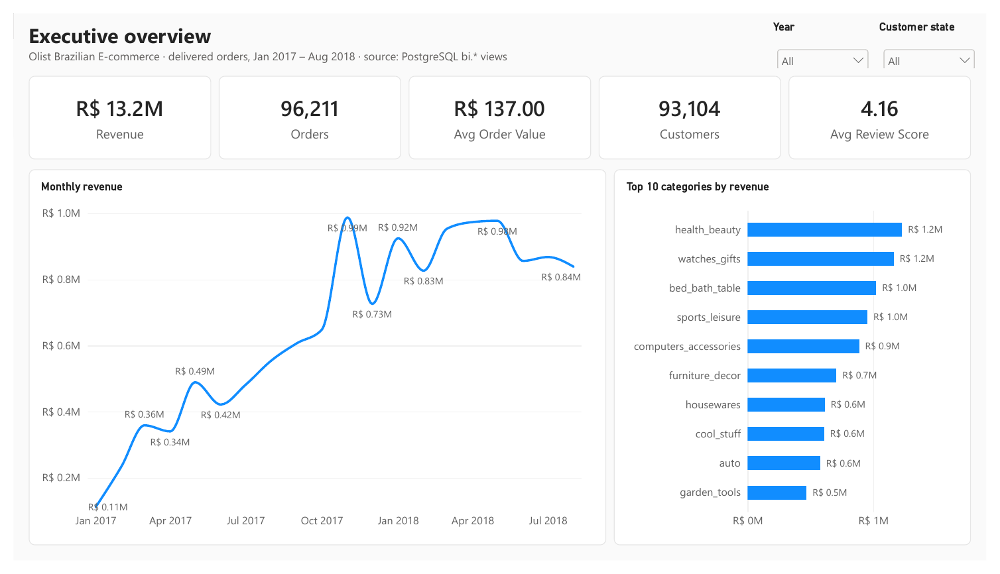
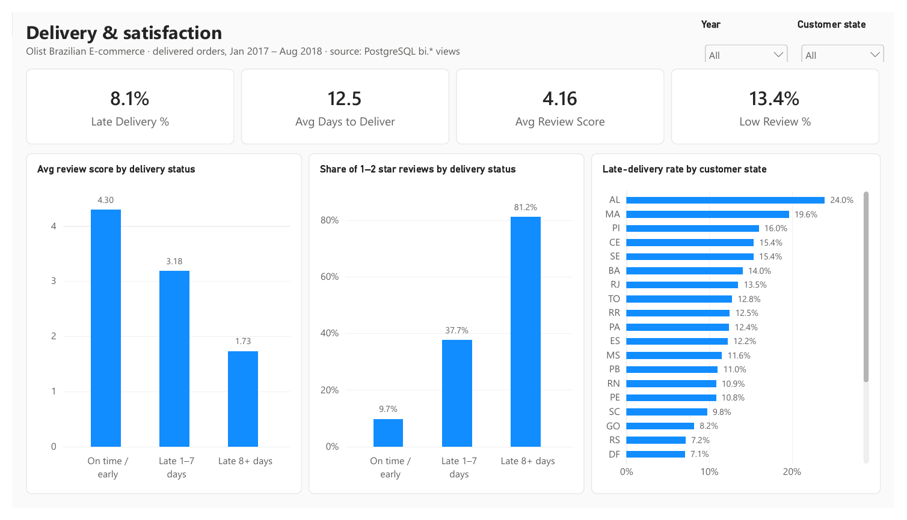
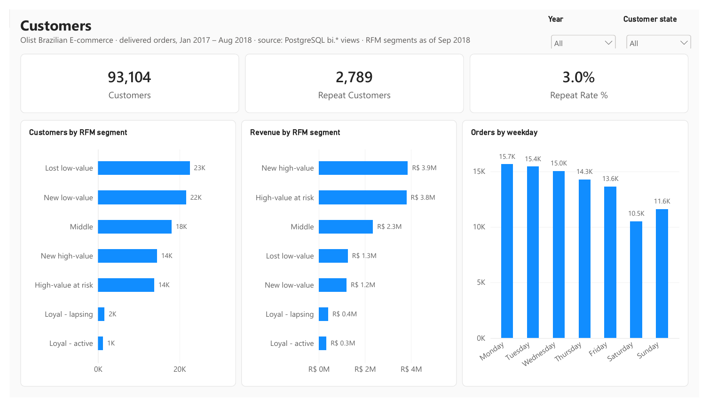

# Power BI dashboard — model and design

The dashboard connects to PostgreSQL (Import mode) and reads only the `bi.*` views created by
`sql/05_powerbi_views.sql`, so every cleaning rule from the data-quality step is applied once, in SQL,
and every visual uses the same definitions.

## The dashboard

Three pages, built in Power BI Desktop and saved as a Power BI project (`olist_dashboard.pbip`).
All measures cover delivered orders, Jan 2017 – Aug 2018; slicers filter by year and customer state.

**1. Executive overview**: revenue, orders, AOV, customers and review score; monthly revenue trend; top 10 categories.

**2. Delivery & satisfaction**: late-delivery rate, delivery time and reviews; review score and 1–2 star share by delivery status; late-delivery rate by state.

**3. Customers**: unique and repeat customers; RFM segments by customers and revenue; orders by weekday.

All three pages as one file: [olist_dashboard.pdf](olist_dashboard.pdf).

### Open it yourself
1. Load the data and run `sql/01`–`05` (see the project README) into a PostgreSQL database called `portfolio`.
2. Open `olist_dashboard.pbip` in Power BI Desktop and click **Refresh**.

The project is stored as text (TMDL model + PBIR report), so every measure, relationship and visual
is readable and diffable on GitHub: see `olist_dashboard.SemanticModel/definition/` and
`olist_dashboard.Report/definition/`.

## Data model (star schema)

| Table | Grain | Role |
|---|---|---|
| `fact_sales` | one row per order item | price, freight, order status |
| `fact_orders` | one row per order | delivery days, late flag, review score, payment |
| `dim_date` | one row per day (Sep 2016 – Dec 2018) | marked as the date table |
| `dim_customer` | one row per order-level customer ID | city, state, `customer_unique_id` |
| `dim_product` | one row per product | English category name |
| `dim_seller` | one row per seller | city, state |
| `customer_rfm` | one row per real customer | recency, frequency, monetary scores and segment |

Relationships are many-to-one and single-direction, from each fact to its dimensions on
`date_key`, `customer_id`, `product_id` and `seller_id`.

## Measures

The model's measures live in `olist_dashboard.SemanticModel/definition/tables/` (`bi fact_sales.tmdl`,
`bi fact_orders.tmdl`); each one applies the delivered-orders filter and the Jan 2017 – Aug 2018 window itself.
[`dax_measures.dax`](dax_measures.dax) is the readable list:

- **Sales:** Revenue, Freight, Orders, Customers, Avg Order Value, Items per Order
- **Time intelligence:** Revenue PM / MoM %, Revenue PY / YoY %, Revenue YTD
- **Delivery and satisfaction:** Late Delivery %, Avg Days to Deliver, Avg Review Score, Low Review %
- **Customers:** Repeat Customers, Repeat Rate %
- **Ranking:** Category Share %, Category Rank (RANKX)

## Pages

1. **Executive overview** — KPI cards (Revenue, Orders, AOV, Customers, YoY %), monthly revenue trend,
   top 10 categories; slicers for year, state and category.
2. **Delivery & satisfaction** — late-delivery and review KPIs, low-review rate by delivery status,
   late-delivery rate by state with conditional formatting.
3. **Customers** — repeat rate, RFM segments by customers and revenue, weekday × hour order heatmap.

## Reconciliation

The `bi.*` views that feed the model reproduce the SQL analysis exactly (Jan 2017 – Aug 2018, delivered orders):

| Metric | SQL analysis (`04_analysis.sql`) | Model views (`bi.*`) |
|---|---|---|
| Orders | 96,211 | 96,211 |
| Revenue | R$13,181,027 | R$13,181,027 |
| Avg order value | R$137.00 | R$137.00 |
| Late delivery | 8.1% | 8.1% |
