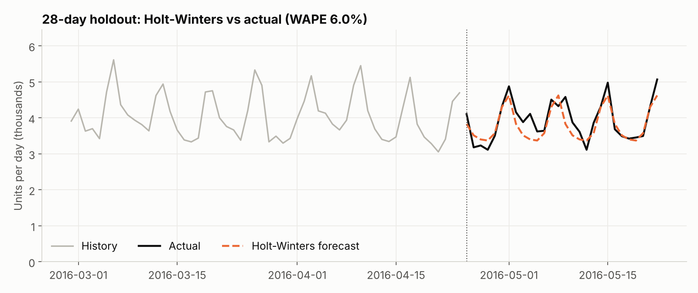
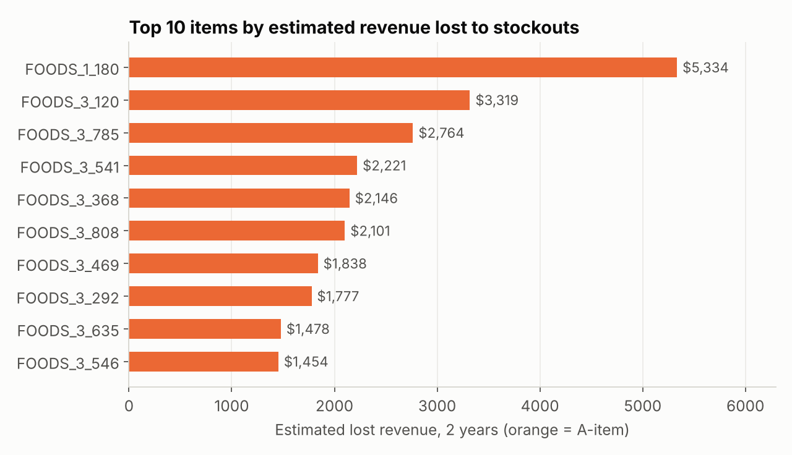
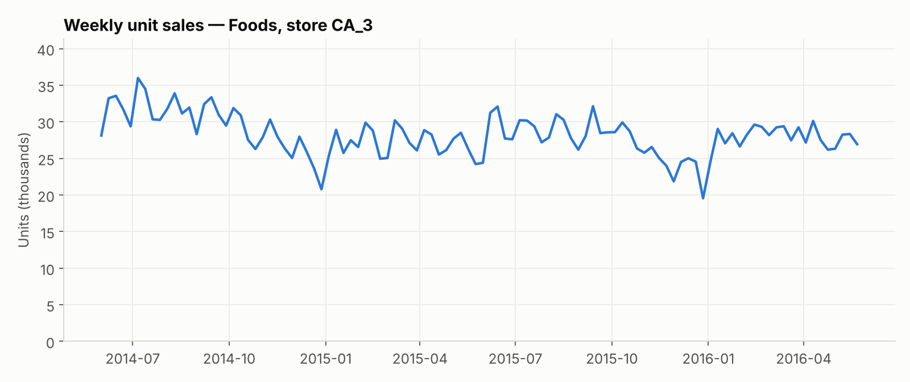
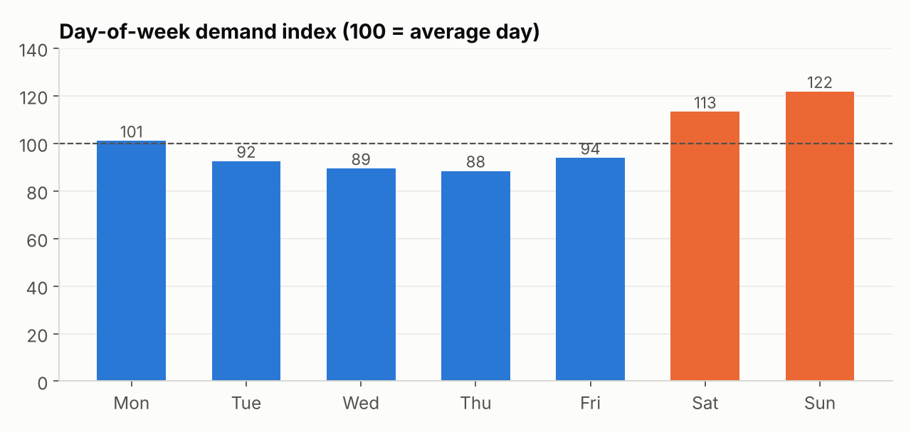
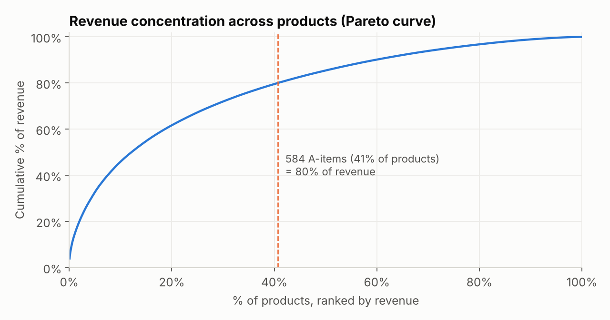

# Retail Demand Forecasting & Inventory Planning — Python

**Business question:** For a Walmart store's food department, how much of each product will sell over the
next 4 weeks, how much safety stock does each product need, and how much revenue is being lost to empty shelves?

**Data:** [M5 Forecasting – Accuracy](https://www.kaggle.com/competitions/m5-forecasting-accuracy/data) —
real Walmart daily unit sales, shelf prices and calendar events. Scope: **store CA_3, Foods, 1,437 products,
104 weeks (26 May 2014 – 22 May 2016)** — about 1 million item-days.

**Tools:** Python · pandas · NumPy · statsmodels (Holt-Winters, exponential smoothing) · SciPy (Welch's t-test) · matplotlib · Jupyter

---

## Key findings

| | Finding | So what |
|---|---|---|
| 📦 | **~28,200 units ($73K) a week**; the last 52 weeks were **−3.7%** vs the year before. | Flat-to-declining demand — tight inventory control matters more than growth planning. |
| 📅 | **Weekends run 13–22% above an average day; SNAP benefit days lift sales 11.1%** (Welch's t-test p < 0.001, positive on all 7 weekdays). | Orders should be front-loaded before weekends and SNAP days, not spread evenly. |
| 🅰️ | **584 A-items (41% of products) make 80% of revenue.** | Focus forecasting effort and buffer stock there. |
| 📈 | **Holt-Winters forecast: 6.0% daily error (WAPE) on a 28-day holdout** vs 6.9% for the seasonal-naive benchmark; the 4-week total was within **3.1%** of actual. | Accurate enough at department level for staffing and DC ordering. |
| 🧮 | At item level, exponential smoothing beat "repeat last week" only modestly (A-item WAPE 28.3% vs 29.4%). | Most item-level noise can't be forecast — buffers and fast shelf checks matter more than fancier models. |
| 🛒 | Safety stock for all items ≈ **33,100 units ($92K)**; A-items hold 76% of that value. Back-test: the policy achieved **95% in-stock on A-items vs a 98% target**. | The formula underestimates lumpy demand — calibrate before rollout (documented in the notebook). |
| 🚫 | **867 likely stockouts on 431 products** (7–28 straight zero-sale days on items that normally sell 2+/day) ≈ **$115K lost revenue (1.5%)**, 85% of it on A-items; median gap 9 days. | A daily zero-sales exception report for A-items is the cheapest win. |




<details><summary>More charts</summary>





</details>

## Recommendations

1. **Daily zero-sales exception report for A-items** — 2+ days of zero sales triggers a shelf check.
2. **Order to the order-up-to levels in `outputs/reorder_plan.csv`** (forecast + safety stock per item), after calibrating the safety factor.
3. **Front-load orders before SNAP days and weekends.**
4. **Spend buffer where it pays** — 98% service for A-items, 90% for C-items.

---

## Approach

| Step | Where | Skills |
|---|---|---|
| 1. Reshape | `src/prepare_data.py` | Wide → long (1,941 day columns → rows), joins to calendar and weekly prices |
| 2. Data quality | Notebook §1 | Duplicates, negatives, missing prices = not yet listed, Christmas closure |
| 3. EDA | §2 | Trend, day-of-week index, SNAP effect with a controlled comparison + hypothesis test |
| 4. ABC–XYZ | §3 | Pareto classification by revenue and demand variability |
| 5. Forecasting | §4 | Train/test split, benchmarks vs Holt-Winters, WAPE / MAPE / bias |
| 6. Inventory policy | §5 | Safety stock, order-up-to levels, service levels, back-test |
| 7. Stockout detection | §6 | Run-length logic on daily sales, lost-sales estimate |

**Assumptions** (replace with real store values): weekly ordering, 1-week lead time, service levels
A 98% / B 95% / C 90%. **Limitation:** no on-hand inventory data, so stockouts are inferred from sales patterns.

## Outputs

- `notebooks/demand_forecasting.ipynb` — full analysis with outputs (GitHub renders it)
- `outputs/reorder_plan.csv` — per item: ABC/XYZ class, 4-week forecast, safety stock, order-up-to level, safety-stock value
- `outputs/stockout_events.csv` — every detected gap with estimated lost units and revenue

## Reproduce it

```bash
pip install -r requirements.txt
# download sales_train_evaluation.csv, calendar.csv, sell_prices.csv from Kaggle into data/raw/
python src/prepare_data.py            # writes data/processed/ (already included in the repo)
jupyter notebook notebooks/demand_forecasting.ipynb
```

`notebooks/demand_forecasting.py` is the same notebook in plain-text (jupytext) form, which keeps diffs readable.
