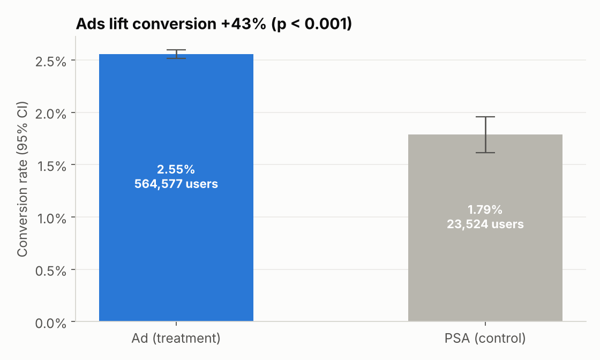
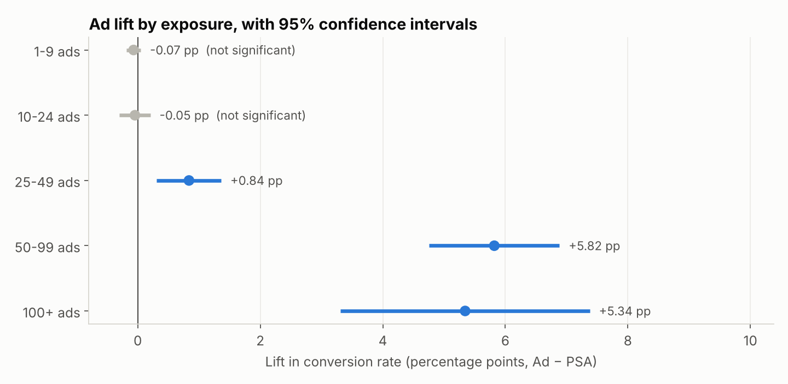

# Marketing A/B Test — Excel + Statistics

**Business question:** A company showed its ad to most users and a public-service ad (PSA) to a small
control group. Did the ad actually cause more conversions, by how much, and should the campaign roll out?

**Data:** [Marketing A/B Testing](https://www.kaggle.com/datasets/faviovaz/marketing-ab-testing) (Kaggle) —
**588,101 users**: test group, converted, total ads seen, and the day/hour they saw the most ads.

**Tools:** Excel (COUNTIFS, named ranges, NORMSDIST/NORMSINV, CHITEST, conditional formatting, charts) ·
Python (pandas, SciPy, statsmodels) for cleaning, verification and power analysis · Tableau

---

## Result

**Roll out the ad.** It lifted conversion from **1.79% to 2.55% (+43% relative)**, z = 7.37, p < 0.001,
95% CI **+0.60 to +0.94 pp** — about **4,300 extra conversions**.

| | Finding |
|---|---|
| ✅ | Two-proportion z-test and chi-square agree (χ² = z² = 54.3). Python reproduces the Excel numbers exactly. |
| 📶 | **Frequency matters:** below 25 ads the ad did no better than the PSA (CIs include zero); at 50–99 ads the lift is **+5.8 pp**. |
| 📅 | Lift was largest when most ads were seen on **Monday/Tuesday**; not significant on Thursday or Sunday. |
| ⚖️ | The 96/4 split gave ~100% power for this effect but could only detect lifts above **~14%** (vs ~6% with 50/50) — matters for the next test. |




Full recommendation for a non-technical manager: **[memo.md](memo.md)**

---

## The workbook — `excel/ab_test_analysis.xlsx`

| Sheet | What's in it |
|---|---|
| **Start Here** | Question, answer, sheet guide, colour legend |
| **Dashboard** | KPI tiles, a headline sentence that rewrites itself from the results, 4 charts |
| **AB_Test** | Group results → z-test → confidence interval → chi-square cross-check → business impact. α and value-per-conversion are input cells. |
| **Segments** | Pivot-style COUNTIFS tables by exposure, day and hour, with lift and a small-sample flag |
| **Data_Quality** | Live validation formulas (blanks, invalid values, outliers) + the cleaning log |
| **Data** | 588,101 cleaned rows behind named ranges (`rng_group`, `rng_conv`, …) |

All **377 analysis cells are formulas** — change α and the decision, interval and dashboard text update.
`src/verify_workbook.py` recalculates the workbook and confirms every formula matches an independent Python
calculation (377 checked, 0 mismatches).

## Approach

1. **Clean** (`src/clean_data.py`) — drop leftover index column, snake_case names, TRUE/FALSE → 1/0, exposure buckets; log every check (0 missing, 0 duplicate users, 0 invalid values; 5,810 heavy users kept).
2. **Build** (`src/build_workbook.py`) — the Excel workbook with live formulas and charts.
3. **Verify** (`notebooks/ab_test_verification.ipynb`) — statsmodels/SciPy re-run, power analysis, segment confidence intervals.
4. **Communicate** — `memo.md` for a non-technical manager, plus a Tableau dashboard design (`tableau/`).

### Statistics used
Two-proportion z-test (pooled SE) · Wald confidence interval (unpooled SE) · chi-square test of independence ·
statistical power and minimum detectable effect · segment-level CIs · small-sample flags ·
correlation-vs-causation caveat on non-randomised exposure.

## Tableau
`tableau/ab_test_tableau_extract.csv` — 1,616 aggregated rows (group × day × hour × exposure bucket) whose totals
reconcile to the raw data. Calculated fields and dashboard layout are in [`tableau/`](tableau/).

## Reproduce it

```bash
pip install pandas numpy scipy statsmodels xlsxwriter openpyxl matplotlib jupyter
# download marketing_AB.csv from Kaggle into data/raw/
python src/clean_data.py
python src/build_workbook.py
jupyter notebook notebooks/ab_test_verification.ipynb
```
